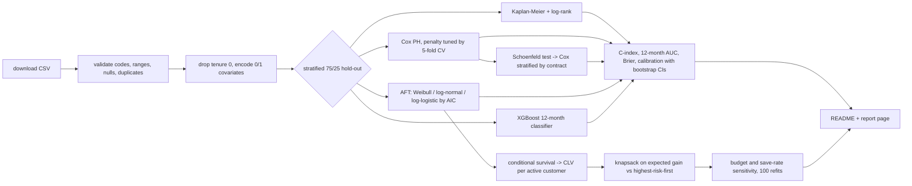
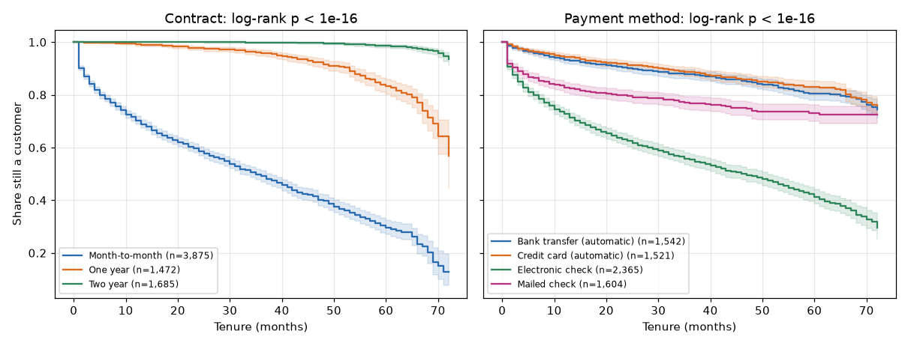
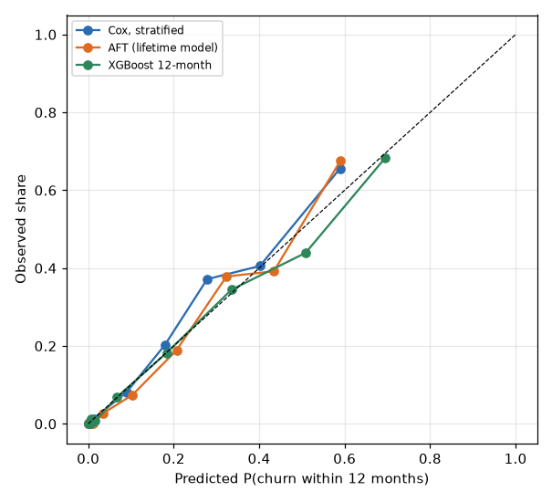
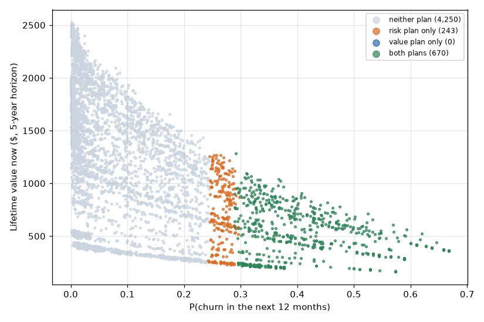
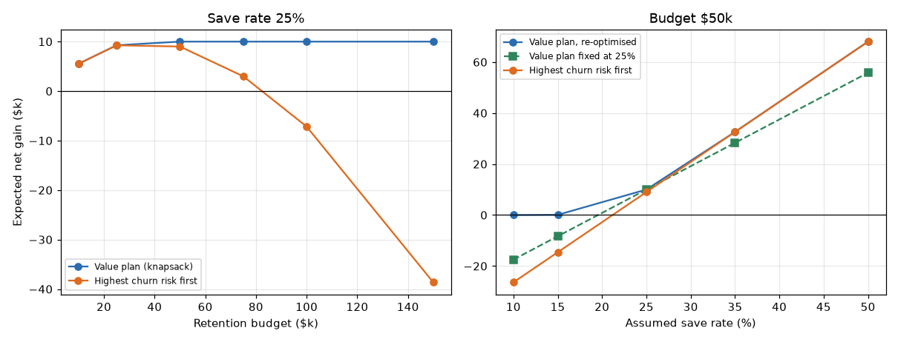
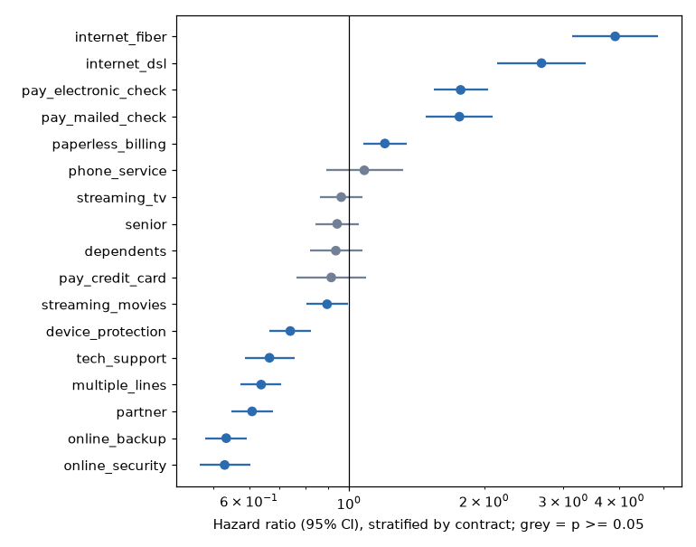
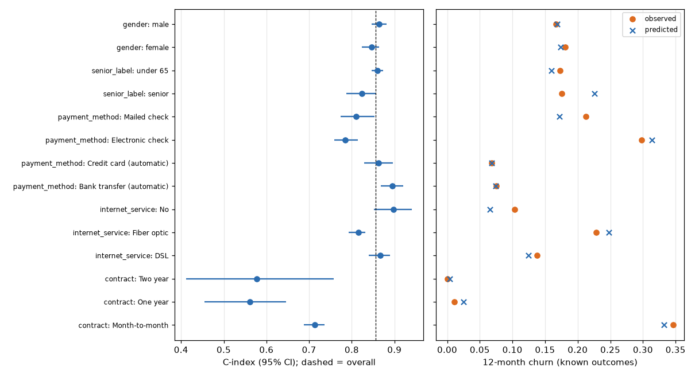

# Customer Churn, Survival and Lifetime Value

[](https://github.com/teozkose/churn-survival-clv/actions/workflows/ci.yml)

[](LICENSE)

## TL;DR

- **Question:** with a fixed retention budget, which telecom customers should get an offer: the ones most likely to leave, or the ones whose departure would cost the most?
- **Headline:** a log-normal survival model ranks 7,032 customers by time to churn with C-index **0.856** (95% CI 0.842–0.869). Turning each curve into a 5-year lifetime value and choosing offers by expected value gained earns **$10.0k** net from 670 offers, against $9.0k from 913 offers when the $50.0k budget goes to the highest churn risks first (difference $995, 95% CI $545 to $1.4k over 100 model refits).
- **Decision:** make the offer to the 670 month-to-month customers the value plan picks, keep the remaining $14.2k, and test the save rate before scaling up: below a 13.9% save rate no offer pays for itself.

## Problem and decision

A subscription business loses customers every month and has a retention budget: here, one month free in exchange for a 12-month commitment. Spending it on whoever looks most likely to leave is the usual rule, but a customer about to leave who pays little is worth less than a steady high-value one with a moderate risk. The retention team needs three things: when customers leave (not only whether), what each active customer is worth, and an offer list that maximises expected value within the budget. The deciding metrics are the concordance index (C-index) for ranking time to churn, calibration of 12-month churn for the probabilities, and expected net gain in dollars for the plan.

## Data

- **Source:** [IBM Telco customer churn](https://github.com/IBM/telco-customer-churn-on-icp4d) sample (Apache 2.0), one CSV downloaded by `make data` and never committed.
- **Size and range:** 7,043 customers of a fictional telecom provider in one snapshot, tenure 0 to 72 months, churn rate 26.5% (churn = left in the snapshot month).
- **Fields:** tenure, contract (month-to-month, one year, two year), phone and internet services and six internet add-ons, paperless billing, payment method, monthly and total charges, gender, senior citizen, partner, dependents.
- **Validation** (`src/churn/validate.py`): required columns, allowed codes for every categorical field, no nulls outside TotalCharges, unique ids, tenure in 0-120, monthly charges in $1-500, add-ons only for customers with internet, multiple lines only with phone service. Any failure stops the run with the full list. Soft findings are counted: 11 blank TotalCharges (all at tenure 0), 6 customers whose TotalCharges is more than 35% away from tenure × monthly price (median gap 2.0%), 22 identical profiles under different ids.
- **Cleaning** (counts from the last run):

| Step | Rows in | Rows flagged | Rows dropped | Rows out |
|---|---|---|---|---|
| drop customers with tenure 0 (signed up, no month billed; TotalCharges blank) | 7,043 | 0 | 11 | 7,032 |
| flag TotalCharges more than 35% away from tenure x monthly price (kept) | 7,032 | 6 | 0 | 7,032 |
| identical profiles under different ids (kept: distinct customers) | 7,032 | 22 | 0 | 7,032 |

Monthly price is almost a linear function of the services held (R² 0.999), so price is left out of the hazard models (it would only duplicate the service flags) and used for value instead.

## Approach



- **Survival setup:** duration = tenure in months, event = churned. Active customers are right-censored at their current tenure.
- **Validation:** a stratified 75/25 hold-out (5,274 / 1,758 customers); the Cox penalty (0.001) and the XGBoost depth (3) and learning rate (0.03) are tuned by 5-fold CV inside the training part. C-index uses every hold-out customer; 12-month metrics use the 1,480 whose 12-month outcome is known.
- **Models:** a baseline that knows only the contract type (one Kaplan-Meier curve per contract); Cox proportional hazards; Cox stratified by contract (one baseline hazard per contract) where the Schoenfeld test rejects proportional hazards; an accelerated failure time (AFT) model, family chosen by AIC, which extrapolates beyond 72 months; and an XGBoost classifier for churn within 12 months, the usual alternative. Gender is never a model input; it is kept for the segment check.
- **Uncertainty:** 500 paired bootstrap resamples of hold-out customers for every metric and model difference; Cox hazard-ratio CIs from the fitted model; 100 bootstrap refits of the lifetime model for the plan values.
- **Lifetime value:** for an active customer at tenure t, P(still paying k months from now) = S(t+k)/S(t). CLV = Σ 45% × monthly bill × S(t+k)/S(t) × discount^k over 60 months at 10% a year.
- **Targeting:** gain of an offer = save rate × (CLV if kept 12 months, then following its own curve − CLV now) − one monthly bill. The value plan solves a 0/1 knapsack with PuLP (maximise total gain, total cost within the budget); the comparison plan offers to the highest 12-month churn probabilities until the budget runs out.
- **Sensitivity check:** the save rate (10% to 50%) and the budget ($10.0k, $25.0k, $50.0k, $75.0k, $100.0k, $150.0k) are varied; the 25% plan is also re-valued at each other save rate as if it had been kept unchanged.

## Results

### Who leaves, and when

| Group | Level | Customers | Churned | Still a customer at 12 m | 24 m | 48 m | 72 m |
|---|---|---|---|---|---|---|---|
| Contract | Month-to-month | 3,875 | 1,655 | 70.3% | 58.6% | 39.7% | 12.9% |
| Contract | One year | 1,472 | 166 | 99.1% | 97.8% | 91.7% | 56.8% |
| Contract | Two year | 1,685 | 48 | 100.0% | 100.0% | 99.6% | 93.6% |
| Payment | Bank transfer (automatic) | 1,542 | 258 | 93.1% | 90.2% | 84.7% | 74.5% |
| Payment | Credit card (automatic) | 1,521 | 232 | 94.5% | 91.3% | 85.5% | 75.8% |
| Payment | Electronic check | 2,365 | 1,071 | 72.7% | 62.4% | 49.3% | 29.5% |
| Payment | Mailed check | 1,604 | 308 | 82.8% | 79.7% | 74.0% | 72.6% |

Retention differs sharply by contract (log-rank χ² 2,353, 2 df, p < 1e-16) and by payment method (χ² 865). Only 12.9% of month-to-month customers reach 72 months, against 93.6% on two-year contracts.



### Model comparison (hold-out)

| Model | C-index (95% CI) | 12-month ROC-AUC (95% CI) | 12-month Brier | Calib. error |
|---|---|---|---|---|
| Baseline: Kaplan-Meier by contract only | 0.768 (0.756–0.782) | 0.799 (0.784–0.814) | 0.1156 | 0.0243 |
| Cox proportional hazards | 0.855 (0.841–0.868) | 0.895 (0.877–0.911) | 0.0964 | 0.0284 |
| Cox, stratified by contract | 0.856 (0.842–0.869) | 0.896 (0.877–0.911) | 0.0959 | 0.0198 |
| Log-normal AFT (lifetime model) | 0.856 (0.842–0.869) | 0.900 (0.881–0.915) | 0.0942 | 0.0257 |
| XGBoost, 12-month churn classifier | 0.857 (0.844–0.869) | 0.906 (0.888–0.919) | 0.0911 | 0.0117 |

Every covariate model beats contract alone by a wide margin (AFT − baseline C-index 0.087, CI 0.074–0.101), and the three survival models rank customers almost identically. The 12-month classifier is slightly sharper on its own question (ROC-AUC +0.007, CI 0.001–0.013) and better calibrated (0.012 vs 0.026), but it was trained on 4,493 customers after dropping 781 whose outcome is not known yet, and it says nothing about month 13 onward, where most lifetime value sits. That is why the survival model, not the classifier, feeds the value calculation.



### Proportional hazards

The Schoenfeld test (rank time) rejects proportional hazards at p < 0.01 for 7 covariates of the plain Cox model: contract_one_year, multiple_lines, online_security, pay_mailed_check, streaming_movies, streaming_tv, tech_support. Stratifying by contract absorbs the contract terms; 5 add-on terms still drift (multiple_lines, online_security, streaming_movies, streaming_tv, tech_support), meaning their protective effect fades with tenure. Stratification changes the C-index by +0.0003 (CI -0.0003–0.0010), so the ranking is robust to the assumption, and the value model is an AFT, which does not assume it.

| Covariate | Schoenfeld χ² | p (Cox) | p (stratified Cox) |
|---|---|---|---|
| contract_one_year | 27.4 | 0.0000 | absorbed by strata |
| multiple_lines | 16.2 | 0.0001 | 0.0004 |
| tech_support | 14.0 | 0.0002 | 0.0003 |
| online_security | 9.4 | 0.0021 | 0.0058 |
| pay_mailed_check | 9.3 | 0.0023 | 0.0104 |
| streaming_tv | 9.3 | 0.0024 | 0.0017 |
| streaming_movies | 8.0 | 0.0046 | 0.0009 |
| contract_two_year | 5.8 | 0.0161 | absorbed by strata |

### Lifetime value

The AFT family with the lowest AIC on the training customers is log-normal:

| AFT family | AIC | Δ AIC |
|---|---|---|
| lognormal | 13,435 | +0 |
| loglogistic | 13,509 | +73 |
| weibull | 13,558 | +123 |

5,163 active customers carry an expected $5.55M of margin over five years (mean $1.1k, median $1.0k, 47.9 expected months of the next 60):

| Contract | Active customers | P(churn, next 12 m) | Expected months (of 60) | Mean CLV | In value plan | In risk plan |
|---|---|---|---|---|---|---|
| Month-to-month | 2,220 | 23.8% | 36.6 | $851 | 670 | 913 |
| One year | 1,306 | 4.0% | 54.4 | $1.2k | 0 | 0 |
| Two year | 1,637 | 1.3% | 58.1 | $1.3k | 0 | 0 |

### Who gets the offer

At a 25% save rate only 670 active customers have a positive expected gain, all on month-to-month contracts. The value plan takes all of them; the risk plan spends the whole budget and includes customers whose offer costs more than it saves.

| Plan | Customers | Spend | Net gain (95% CI) | Expected saves | Mean churn risk | Mean CLV |
|---|---|---|---|---|---|---|
| Value plan (knapsack on expected gain) | 670 | $35.8k | $10.0k ($8.8k to $11.2k) | 67 | 40.1% | $504 |
| Highest churn probability first | 913 | $50.0k | $9.0k ($7.5k to $10.6k) | 83 | 36.5% | $562 |

The plans overlap on 670 customers: every customer the value plan picks is also in the risk plan. With this offer the expected gain rises with churn risk almost everywhere, because high-value customers are high-value precisely because they are unlikely to leave. So the answer to the opening question is "risk first, but know where to stop": the knapsack's contribution is the stopping point, not a different list. The value plan wins in 100% of 100 refits of the lifetime model, returns 28% on spend against 18%, and keeps $14.2k of the budget.



### Sensitivity to the save rate and the budget

| Save rate | Value plan size | Value plan gain | Gain of the 25% plan kept as is | Risk plan gain |
|---|---|---|---|---|
| 10% | 0 | $0 | -$17.5k | -$26.4k |
| 15% | 35 | $80 | -$8.3k | -$14.6k |
| 25% | 670 | $10.0k | $10.0k | $9.0k |
| 35% | 910 | $32.6k | $28.3k | $32.6k |
| 50% | 910 | $68.0k | $55.8k | $68.0k |

| Budget | Value plan size | Value plan spend | Value plan gain | Risk plan gain |
|---|---|---|---|---|
| $10.0k | 161 | $10.0k | $5.5k | $5.5k |
| $25.0k | 423 | $25.0k | $9.3k | $9.3k |
| $50.0k | 670 | $35.8k | $10.0k | $9.0k |
| $75.0k | 670 | $35.8k | $10.0k | $3.0k |
| $100.0k | 670 | $35.8k | $10.0k | -$7.2k |
| $150.0k | 670 | $35.8k | $10.0k | -$38.6k |

The save rate drives everything. At 10% no offer pays (break-even is 13.9% for the best customer), and spending the budget on the riskiest customers loses -$26.4k. At higher save rates both plans grow and converge, because more offers pay off. The budget curve shows the other failure of the risk-first rule: at $150.0k it falls to -$38.6k, while the value plan stays at $10.0k because it stops when offers stop paying.



## What drives it / error analysis

Hazard ratios from the Cox model stratified by contract, fitted on every customer (top 10 by distance from 1 among p < 0.05):

| Covariate | Hazard ratio | 95% CI | p |
|---|---|---|---|
| internet_fiber | 3.91 | 3.14–4.87 | 0 |
| internet_dsl | 2.68 | 2.13–3.37 | 0 |
| pay_electronic_check | 1.77 | 1.54–2.04 | 0 |
| pay_mailed_check | 1.76 | 1.48–2.09 | 0 |
| online_security | 0.53 | 0.47–0.60 | 0 |
| online_backup | 0.53 | 0.48–0.59 | 0 |
| partner | 0.61 | 0.55–0.68 | 0 |
| multiple_lines | 0.64 | 0.58–0.71 | 0 |
| tech_support | 0.67 | 0.59–0.76 | 0 |
| device_protection | 0.74 | 0.67–0.82 | 0 |

Fiber internet carries 3.91× the churn hazard of no internet (DSL 2.68×), electronic-check payment 1.77×; online security (0.53×), online backup (0.53×), tech support (0.67×) and having a partner (0.61×) go with staying. Add-ons look like switching costs: the more of the bundle a customer uses, the longer they stay.



Errors by segment on the hold-out customers (lifetime model):

| Segment | Level | Customers | Churned | C-index (95% CI) | Observed 12-m churn | Predicted |
|---|---|---|---|---|---|---|
| Contract | Month-to-month | 978 | 414 | 0.713 (0.687–0.736) | 34.6% | 33.3% |
| Contract | One year | 372 | 43 | 0.562 (0.454–0.646) | 1.1% | 2.5% |
| Contract | Two year | 408 | 10 | 0.577 (0.412–0.758) | 0.0% | 0.4% |
| Internet | DSL | 604 | 113 | 0.867 (0.840–0.889) | 13.8% | 12.4% |
| Internet | Fiber optic | 772 | 323 | 0.816 (0.793–0.832) | 22.8% | 24.8% |
| Internet | No | 382 | 31 | 0.897 (0.852–0.941) | 10.4% | 6.6% |
| Payment | Bank transfer (automatic) | 384 | 71 | 0.894 (0.868–0.920) | 7.5% | 7.5% |
| Payment | Credit card (automatic) | 384 | 58 | 0.863 (0.829–0.896) | 6.9% | 6.8% |
| Payment | Electronic check | 578 | 264 | 0.784 (0.759–0.814) | 29.8% | 31.4% |
| Payment | Mailed check | 412 | 74 | 0.810 (0.773–0.853) | 21.2% | 17.2% |
| Age | senior | 285 | 115 | 0.823 (0.787–0.857) | 17.6% | 22.6% |
| Age | under 65 | 1,473 | 352 | 0.860 (0.847–0.873) | 17.3% | 16.0% |
| Gender | female | 849 | 232 | 0.847 (0.824–0.865) | 18.1% | 17.4% |
| Gender | male | 909 | 235 | 0.864 (0.847–0.881) | 16.7% | 16.8% |

Within one contract type the ranking is much weaker than overall: contract carries most of the signal, and among one- and two-year customers there are too few churners for a precise C-index. Predicted 12-month churn tracks the observed rate in most segments; the model over-predicts for seniors and under-predicts for customers without internet and for mailed-check payers.



## Limitations and next steps

- **One snapshot.** Tenure is observed once, and customers who left before the snapshot month are not in the file. Long-tenure retention is therefore likely overstated, and every curve beyond 72 months is extrapolation by the parametric model. A panel of monthly customer records would allow proper left truncation.
- **Current attributes.** Contract, services and payment method are today's values; a customer who upgraded may look stickier than they were.
- **Assumed economics.** Margin (45%), discount rate, offer cost and above all the save rate are assumptions in `config.yaml`. The save rate is not measured here; a randomised test of the offer on a few hundred customers would replace it and would also show whether the offer works better for some segments (uplift modelling).
- **Teaching sample.** The data is a public sample built for demonstrations, not a real operator's book.
- **Next:** time-varying covariates once monthly records exist; a cure-rate model for customers who will effectively never leave; uplift modelling once offer data exist.

## Reproduce

```bash
python -m venv .venv && source .venv/bin/activate
pip install -r requirements.txt -r requirements-dev.txt
make all     # data -> features -> run -> report -> notebook, about 48 s for the run stage
make test    # 14 tests on synthetic customers, no download
```

`run_all.sh` runs the same steps. Every number above is read from `results/metrics.json` by `src/churn/report.py`; the report page is `docs/index.html`.

## Project structure

```
├── config.yaml              paths, model grid, CLV and offer assumptions
├── Makefile / run_all.sh    data, features, run, report, notebook
├── data/download.py         fetches the CSV (data files are not committed)
├── src/churn/
│   ├── data.py              download and tidy
│   ├── validate.py          schema, codes, ranges, nulls, duplicates
│   ├── features.py          survival table, 0/1 covariates, 12-month label
│   ├── survival.py          Kaplan-Meier, Cox, stratified Cox, AFT, log-rank, PH test
│   ├── models.py            XGBoost 12-month classifier with inner-CV tuning
│   ├── evaluate.py          C-index, AUC, Brier, calibration, bootstrap CIs, segments
│   ├── clv.py               conditional survival, expected lifetime, CLV
│   ├── targeting.py         expected gain, knapsack (PuLP), risk-first plan
│   ├── figures.py           PNG figures
│   ├── pipeline.py          stages
│   └── report.py            README.md and docs/index.html from metrics.json
├── tests/                   pytest on synthetic customers
├── notebooks/01_analysis.ipynb
├── results/                 metrics.json and figures
└── docs/index.html          report page
```
